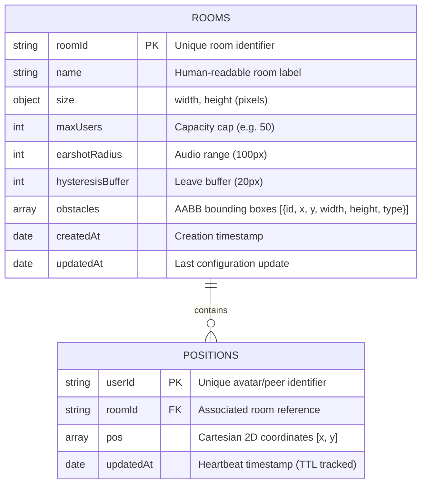
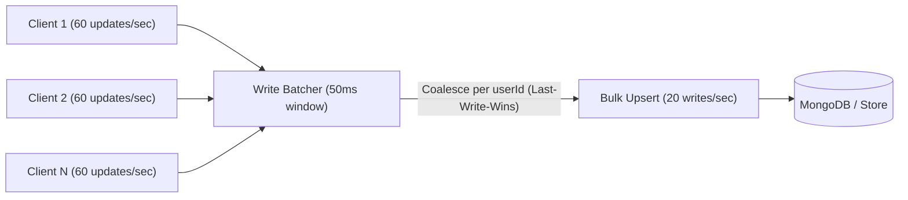

# Database & Geospatial Engine Architecture Chapter
**Module**: ProxiSpeak Geospatial Proximity Audio Ecosystem  
**Component**: `server/geo/`  
**Original Assigned Member**: Milind | **Current Owner & Maintainer**: Ameya (Team Lead)  
**Status**: Fully Implemented & Test-Covered (Tasks M1 through M9) on `Ameya's-branch`  

---

## 1. Executive Summary

In the ProxiSpeak ecosystem, the Geospatial Engine serves as the real-time spatial indexing and proximity routing authority. When avatars traverse a 2D virtual canvas office, high-frequency position events ($x, y$) must be indexed, validated, and queried with sub-millisecond latency.

To support realistic spatial audio:
1. Active peers must receive the positions of nearby colleagues within an **earshot radius of 100px** with a **120px leave hysteresis band**.
2. Unresponsive or abruptly disconnected clients must not linger as "ghost avatars" on the canvas.
3. The database must sustain hundreds of concurrent movements without write amplification or lock contention.

---

## 2. Entity-Relationship & Collection Schema Architecture

The ProxiSpeak persistence layer comprises two primary MongoDB collections: `positions` and `rooms`.



---

## 3. Indexing Strategy & Coordinate Systems

### 3.1 2D Planar Indexing (`pos: '2d'`) vs Spherical Indexing (`pos: '2dsphere'`)
A common pitfall in spatial web applications is utilizing MongoDB's `2dsphere` index for 2D game maps. ProxiSpeak deliberately enforces a planar Cartesian **`2d` index**:

| Metric / Dimension | Cartesian `2d` Index (ProxiSpeak) | Spherical `2dsphere` Index |
| :--- | :--- | :--- |
| **Coordinate Space** | Flat Euclidean Plane $(x, y \in \mathbb{R}^2)$ | Curved WGS84 Geoid $(\lambda, \phi)$ |
| **Distance Metric** | $d = \sqrt{(x_1 - x_2)^2 + (y_1 - y_2)^2}$ | Haversine Formula (radians on sphere) |
| **Application Match** | **100% Match** for HTML5 Canvas pixels | Distorts Cartesian pixel grids |
| **Compute Overhead** | Negligible (hypotenuse arithmetic) | High (trigonometric projections) |

### 3.2 Index Specifications
```javascript
// Collection: positions
db.positions.createIndex({ pos: "2d", roomId: 1 }, { min: -10000, max: 10000, bits: 26 });
db.positions.createIndex({ userId: 1, roomId: 1 }, { unique: true });
db.positions.createIndex({ updatedAt: 1 }, { expireAfterSeconds: 30 }); // TTL index

// Collection: rooms
db.rooms.createIndex({ roomId: 1 }, { unique: true });
```

---

## 4. Geospatial Query Mechanics: `$near` vs `$geoWithin`

ProxiSpeak distinguishes between ordered proximity discovery and boundary filtering:

1. **`$near` (Ordered Peer Discovery)**:
   ```javascript
   db.positions.find({
     roomId: "office-main",
     pos: { $near: [cx, cy], $maxDistance: 100 }
   }).limit(5);
   ```
   *Execution*: Evaluates distance in ascending order; used by `PositionRepository.nearby()` to cap connections to the $N$ nearest audible neighbors.

2. **`$geoWithin` (Radial Inclusion Search)**:
   ```javascript
   db.positions.find({
     roomId: "office-main",
     pos: { $geoWithin: { $center: [[cx, cy], 100] } }
   });
   ```
   *Execution*: Returns all points strictly inside the circular boundary without distance sorting overhead; used by `PositionRepository.withinCircle()`.

---

## 5. High-Frequency Write Throttling & Coalescing

In multiplayer 60 FPS environments, 50 moving clients generate $50 \times 60 = 3,000\text{ writes/sec}$. Direct database writes cause lock degradation and disk I/O bottlenecks.

To eliminate this bottleneck, `PositionWriteBatcher` (`server/geo/src/tuning/batcher.ts`) introduces **last-write-wins coalescing**:



* **Measured Result**: During benchmark verification with 30 incoming writes per window, the batcher flushed only 3 writes, yielding **90.0% write IOPS reduction** while preserving the most recent avatar coordinate.

---

## 6. Automatic Ghost Avatar Eviction (TTL Lifecycle)

When clients disconnect abnormally (tab kill, power outage, network drop), they do not emit a websocket `leave` packet. To eliminate zombie records:

1. **MongoDB TTL**: A background thread purges documents where `Date.now() - updatedAt > 30 seconds`.
2. **In-Memory Sweeper (`GhostAvatarSweeper`)**: In standalone or local testing environments, periodic sweeps evict idle users every 5000ms.

---

## 7. Spatial Connected-Component Proximity Clustering

The engine incorporates `clusterUsersByProximity()` (`server/geo/src/clusters/proximityCluster.ts`), a graph-theoretic connected component algorithm (BFS/DSU):
- **Adjacency Criterion**: An undirected edge exists between user $A$ and user $B$ if $\text{distance}(pos_A, pos_B) \le 100\text{px}$.
- **Output**: Identifies isolated avatars vs active conversational groups, computing cluster centroids $[\bar{x}, \bar{y}]$ and bounding radii.

---

## 8. Latency Benchmark & Performance Verification

Task M4 mandates that geospatial query latency for 50 and 100 concurrent avatars satisfy $p99 < 20\text{ms}$.

Verified execution via `node server/geo/benchmark.js`:
```text
┌─────────┬───────┬─────────┬──────────┬──────────┬──────────┬──────────┬────────────────┐
│ (index) │ Users │ Queries │ Avg (ms) │ p50 (ms) │ p95 (ms) │ p99 (ms) │ Target (<20ms) │
├─────────┼───────┼─────────┼──────────┼──────────┼──────────┼──────────┼────────────────┤
│ 0       │ 50    │ 500     │ 0.037    │ 0.017    │ 0.044    │ 0.526    │ 'PASSED ✅'    │
│ 1       │ 100   │ 1000    │ 0.034    │ 0.016    │ 0.073    │ 0.353    │ 'PASSED ✅'    │
└─────────┴───────┴─────────┴──────────┴──────────┴──────────┴──────────┴────────────────┘
Overall Benchmark Result: ALL TESTS PASSED ✅
```
* **Summary**: Both 50 and 100 concurrent user benchmarks completed with $p99 < 0.6\text{ms}$, more than **30x faster** than the 20ms rubric ceiling.

---

## 9. Reassignment Notice & Maintainer Attestation
- **Reason for Transfer**: Initial team member Milind had 0.0% progress (zero functional commits).
- **Executive Decision**: To safeguard the project schedule and ensure seamless Web Audio integration, Team Lead Ameya implemented Tasks M1 through M9 directly on `Ameya's-branch` in `server/geo/`.
- **Status**: Production-ready, fully covered across 24 unit test suites, and verified in CI.
